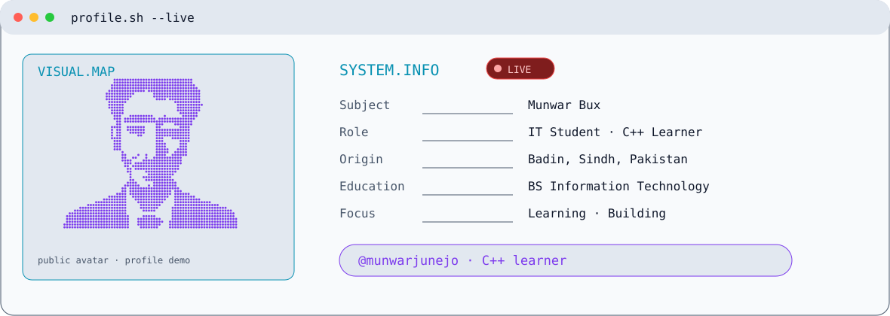

<picture>
<source media="(prefers-color-scheme: dark)" srcset="https://raw.githubusercontent.com/munwarjunejo/munwarjunejo/main/dark.svg">
<source media="(prefers-color-scheme: light)" srcset="https://raw.githubusercontent.com/munwarjunejo/munwarjunejo/main/light.svg">

</picture>
 

# Hi, I am Munwar Bux

**BS Information Technology student | Learning Java and C++**

I am learning programming by building small console programs and practice projects. Most of my current work is focused on Java basics, C++ fundamentals, and improving my problem-solving skills.

## What I am learning

- Java variables, conditions, loops, methods, and classes
- C++ variables, conditions, loops, arrays, and structures
- Basic object-oriented programming
- Data structures and simple algorithms
- Writing clear and readable code

## Selected repositories

| Repository | Description |
|---|---|
| [Personal_Expense_Budget_Tracker](https://github.com/munwarjunejo/Personal_Expense_Budget_Tracker) | Java console app for recording income and expenses and setting a monthly budget |
| [Java-Learning-Codes](https://github.com/munwarjunejo/Java-Learning-Codes) | Java examples and practice programs |
| [Cpp-Learning-Notes](https://github.com/munwarjunejo/Cpp-Learning-Notes) | C++ notes and practice programs |
| [Calculator-Cpp](https://github.com/munwarjunejo/Calculator-Cpp) | A simple C++ calculator using a menu and switch statements |
| [Number-Guessing-Game-Cpp](https://github.com/munwarjunejo/Number-Guessing-Game-Cpp) | A small C++ number guessing game |
| [Fibonacci-Series-Cpp](https://github.com/munwarjunejo/Fibonacci-Series-Cpp) | C++ examples using loops, functions, and recursion |
| [Tea-Shake-Coffee-Ordering-Cpp](https://github.com/munwarjunejo/Tea-Shake-Coffee-Ordering-Cpp) | A simple C++ menu program for ordering tea, shakes, and coffee |

## About me

- **Location:** Badin, Sindh, Pakistan
- **Education:** BS Information Technology
- **Institute:** The Sufi Institute of Luari Sharif, Badin
- **Languages:** Java and C++
- **Tools:** VS Code, Eclipse, and Dev-C++

I am still learning and adding new practice projects as I go.

## Connect with me

